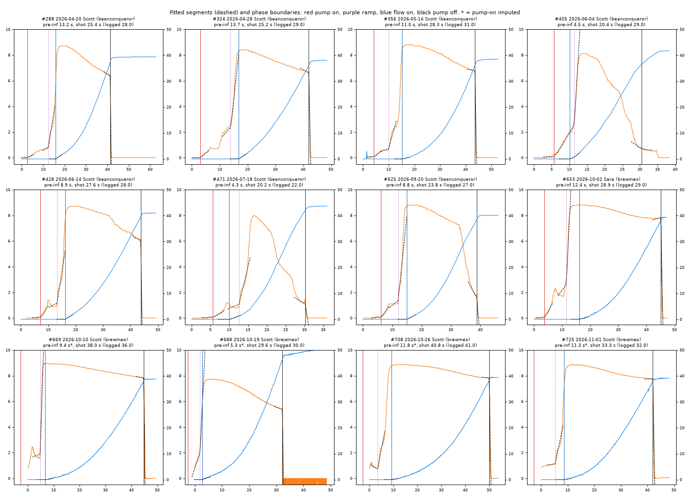
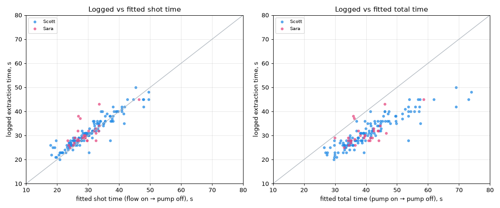
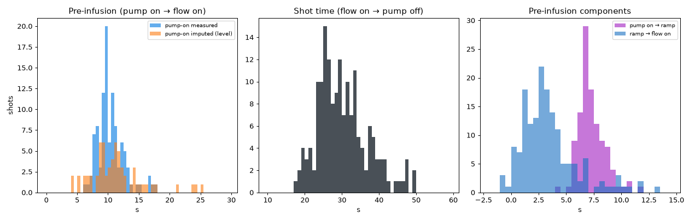
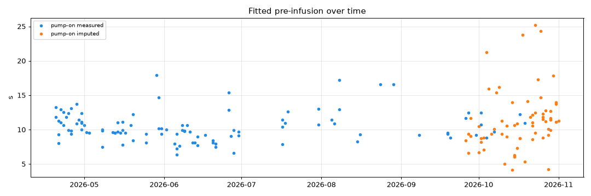
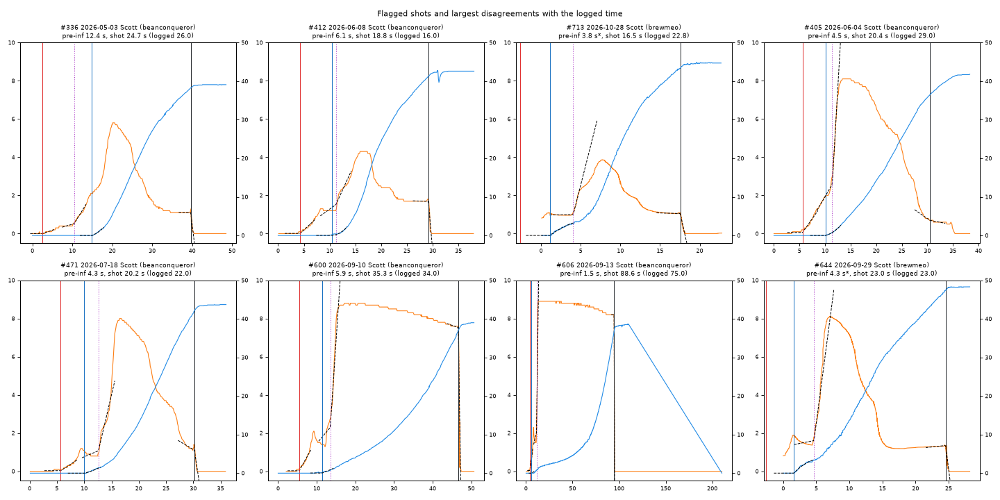

# Telemetry phase estimation: pre-infusion and shot time

**Status:** exploration only. Nothing in the application has changed. This
report is for review and refinement before any implementation.
**Data:** all 185 shots with telemetry as of 2026-11-01.

## Goal

Estimate two durations from each shot's telemetry:

| Quantity | Definition | Boundaries |
|---|---|---|
| **Pre-infusion** | pressure first rises → flow begins | `t_pump_on` → `t_flow_on` |
| **Shot time** | flow begins → pressure is removed | `t_flow_on` → `t_pump_off` |

Each boundary is found by fitting ideal curve segments on either side of a
transition and taking the point where they intersect.

## 1. What the telemetry looks like

| | Beanconqueror | Brewmeo (CSV import) |
|---|---|---|
| Shots | 101 (Apr–Sep 2026) | 84 (Sep–Nov 2026) |
| Series used | `pressureFlow.actual_pressure`, `weight.actual_smoothed_weight` | same (converted by `brewmeo_import`) |
| Sampling | ~10 Hz, `brew_time` in `S.T` tenths notation | ~10 Hz |
| Recording starts | before the pump (pressure = 0) | **auto-starts at ~0.85 bar**; 56 of 84 start at 0.8–0.9 bar |

Every shot here is from the ECM Synchronika II, and 175 of the 185 are logged
as `5+3` pre-infusion. The pressure trace has a consistent shape (see the
figure below):

1. **Pump on.** Pressure rises from 0 to a low line-pressure plateau of about
   1–2 bar. This is the manual pre-infusion.
2. **Ramp.** About 7 s later, pressure climbs steeply to about 9 bar.
3. **Plateau.** Pressure slowly declines as the puck erodes. On flow-taper
   shots the user eases it down to about 1 bar.
4. **Pump off.** A near-vertical drop to 0.

Weight stays flat at the tare until the first drips, then rises along a
convex curve. Flow (`realtimeFlow`) is the derivative of weight, so it is
noisier and carries no extra information. The estimates below fit weight
directly.

**Data quality issues:**

- **7 truncated recordings** (Brewmeo; shots 657, 658, 660, 664, 668, 687,
  705) start at 8–9 bar, partway through the shot. Neither boundary at the
  start can be recovered.
- **1 recording has no pressure data** (shot 706).
- **Brewmeo recordings that auto-start** miss the pump-on edge. For these 63
  shots, `t_pump_on` has to be imputed (see §3).
- **Occasional weight spikes** from a bumped cup or scale. A 5-sample
  running median removes them.
- **Shot 606:** the scale log interpolates linearly out to 200 s, so the
  shot is mostly unusable.



## 2. Method: two-segment fits at each transition

Every boundary uses one generic routine, `fit_breakpoint` in
[`phase_fit.py`](phase_fit.py). It fits a **continuous two-segment curve** by
least squares:

- left segment: a constant, or a line;
- right segment: a polynomial in `(t − t0)`;
- a grid search over the knot `t0` (0.05 s steps) picks the best fit.

Because the two segments are joined at `t0`, the knot *is* their
intersection point.

| Boundary | Signal and window | Left segment | Right segment |
|---|---|---|---|
| `t_pump_on` | pressure, from the start until pressure reaches 70% of the pre-infusion plateau | flat baseline | rising line |
| `t_ramp` *(context only)* | pressure, from pump on + 0.5 s until pressure reaches 60% of peak | sloped plateau line | ramp line |
| `t_flow_on` | weight, from pump on until the cup holds 4 g | flat baseline (tare) | **quadratic** rise |
| `t_pump_off` | pressure, from 2 s before the last sample above 0.7 bar until pressure reaches 0 | sloped (declining) plateau line | steep drop line |

Two design choices came out of reviewing the first fits:

- **Pump-off uses an absolute 0.7 bar level, not a fraction of peak.** On
  flow-taper shots, pressure falls gradually from 8 to about 1 bar and only
  then drops to 0. An early version keyed on 50% of peak. It cut taper shots
  in the middle of the taper, 5–10 s early.
- **Flow-on uses a quadratic rise, not a tangent line.** Weight accelerates
  as flow builds, so a straight line fitted to the rise is too shallow. It
  puts the intersection late, and how late depends on how much of the rise
  the window includes. See the sensitivity table in §4.

## 3. Imputing pump-on for Brewmeo auto-start recordings

63 usable Brewmeo shots begin at about 0.85 bar, after the pump has already
started. Two calibrations were tested. Both use the 110 recordings that
captured the pump-on edge:

| Calibration | Assumption | Offset (median, IQR) | Imputed pre-infusion (median, IQR) |
|---|---|---|---|
| **Level** | the time to reach ~0.85 bar is the same on every shot | 2.65 s (2.25–3.69) | 10.6 s (8.8–12.6) |
| **Ramp-aligned** | pump on → ramp takes the same time on every shot (the manual routine) | 7.05 s (6.60–7.89) | 10.4 s (9.2–13.0) |

Both give about the same answer, and both agree with the 104 shots where
pump-on was measured directly (median **9.95 s**, IQR 9.25–11.4). The spread
is larger for imputed shots (SD 4.4 s vs 2.2 s). At least part of that is
real. Ramp → flow on does not depend on pump-on at all, and its SD also
widens, from 2.3 s before mid-September to 4.0 s after. The rest is
imputation noise. The current code uses the level calibration.

## 4. Results

### Validation: fitted shot time matches the logged extraction time

The logged `extraction_time` is entered by hand from a timer. It turns out
to measure **flow on → pump off**, the same thing the fitted shot time
measures:

| Maker | n | logged − fitted shot time, median (IQR) | logged − fitted *total* time, median |
|---|---|---|---|
| Scott | 137 | +1.3 s (+0.15 to +2.3) | −9.0 s |
| Sara | 30 | +0.9 s (+0.06 to +1.9) | −9.5 s |

- **81%** of the 167 usable shots agree within ±3 s, and 64% within ±2 s.
- Logged times run about 1 s longer than fitted times. That is consistent
  with starting the timer at the first visible drip, slightly before the
  extrapolated stream onset, or stopping it a moment after the pump stops.
- Flow-taper shots: 74% within ±3 s, compared with 83% for the rest.



### Distributions

| Quantity | n | median | IQR |
|---|---|---|---|
| Pre-infusion, pump-on measured | 104 | 9.95 s | 9.25–11.4 |
| Pre-infusion, pump-on imputed | 63 | 10.6 s | 8.8–12.6 |
| Shot time | 167 | 29.2 s | 25.3–33.6 |
| Pump on → ramp | 110 | 7.05 s | 6.6–7.9 |
| Ramp → flow on | 167 | 2.95 s | 1.7–4.4 |

The logged `5+3` lines up with these components. Pump on → ramp is about 7 s
(the "5" plus the time to open the paddle), and ramp → flow on is about 3 s
(the "+3"). Ramp → flow on does not depend on pump-on at all, so it is also
available for the auto-start Brewmeo shots.




### Flow-onset sensitivity

Agreement with the logged time for each choice of rise segment and fit
window:

| Rise segment | window ends at | median logged − fitted | median abs diff | within ±3 s | median measured pre-infusion |
|---|---|---|---|---|---|
| line (tangent) | 2 g | +1.65 | 1.90 | 74% | 10.2 s |
| line (tangent) | 4 g | +2.00 | 2.15 | 67% | 10.75 s |
| line (tangent) | 8 g | +3.03 | 3.08 | 47% | 11.5 s |
| **quadratic** | 2 g | +0.90 | 1.45 | 81% | 9.8 s |
| **quadratic** | **4 g (chosen)** | +1.25 | 1.55 | 80% | 9.95 s |
| quadratic | 8 g | +0.88 | 1.40 | 79% | 9.7 s |

The quadratic fit is stable whatever the window. The tangent-line fit drifts
later as the window widens.

## 5. Where it disagrees, and why

11 of Scott's shots differ from the logged time by more than 5 s:

| Pattern | Shots | Likely cause |
|---|---|---|
| Logged value is a typo | 363 (logged 96, fitted 36.7) | Data entry. The telemetry could catch this at save time. |
| Logged ≈ ramp → pump off | 289, 330, 431, 465 (Apr–Jul) | The timer was started at the ramp, not the first drip. These are early `5+5` shots. |
| Long, slow drip before a steady stream | 569, 656, 661 | Fine grind or slow start. "Flow begins" is ambiguous here: first drips or established stream? (See Q2 in §6.) |
| Early drips during pre-infusion | 681, plus 8 flagged `flow_before_ramp` | Real channel or drip flow before the ramp. Pre-infusion comes out short (2–6 s). |
| Other | 458, 466 | Not investigated. |

Other flags: `low_peak_pressure` (336, 412, 713) marks shots that never
reached 6 bar, which are gushers or deliberately profiled shots. The fits
still look reasonable on them.



## 6. Decisions needed before implementation

1. **Pump-on for auto-start recordings.**
   - Option (a): impute it as described in §3.
   - Option (b): report pre-infusion only when pump-on was measured, and
     report `ramp → flow on` for every shot.
   - Option (c): change the Brewmeo auto-start trigger, if the app allows
     it.
   - *Recommendation:* (a), storing an `imputed` flag alongside the value.
2. **What "flow begins" means.**
   - The current definition is the extrapolated onset of the weight rise.
     It matches the logged timer best.
   - The alternative is the first drip: a weight threshold such as 0.3 g.
     That would make the slow-drip shots longer.
   - *Recommendation:* keep the current definition.
3. **Truncated recordings (7 shots).** Show "n/a", or estimate shot time
   from the recording start? *Recommendation:* show "n/a".
4. **Use the result to check entries.** Warn on save when the logged
   extraction time differs from the fitted shot time by more than 5 s
   (would have caught shot 363). Optional.

## 7. Implementation sketch (pending approval)

- `coffee_records/services/telemetry_phases.py`: port `phase_fit.py` with
  thresholds in `config.yaml` (`telemetry_phases:` block) and a Pydantic
  result model (`pre_infusion_s`, `shot_time_s`, `t_*`, `pump_on_imputed`,
  `flags`).
- Compute the phases on telemetry upload. Either store them in new nullable
  `shots` columns, or compute them on read from the stored JSON; the fit
  takes about 30 ms per shot.
- Add a `bin/` backfill script for existing shots, in the style of
  `backfill_telemetry_thumbnails.py`.
- Show the phase markers in `TelemetryModal`, and add the fitted
  pre-infusion and shot time to the shot card and reports.
- Tests: use synthetic piecewise curves with known breakpoints, plus the
  existing Beanconqueror fixture.

## Reproducing

Load database credentials with direnv, then run from the repo root:

```bash
poetry run python notebooks/telemetry_phases/explore.py \
    --telemetry-dir /var/www/html/resources/coffee/telemetry
```

The script writes `results/phases.csv` (one row per shot, with all
boundaries and flags), `results/summary.json` and `figures/*.png`.
